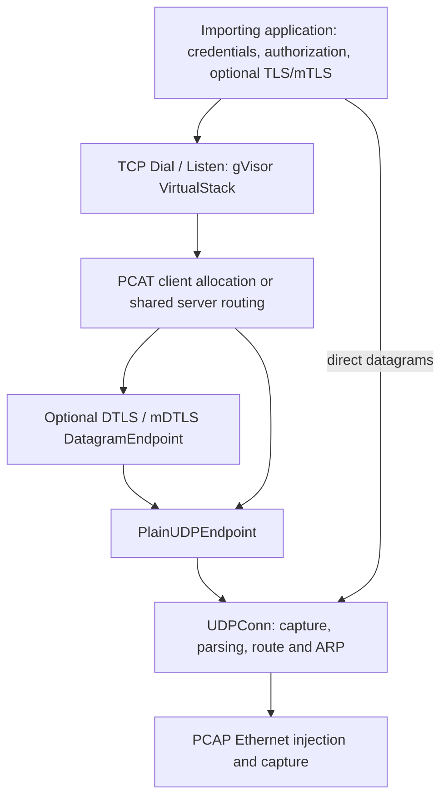

# Architecture and resource ownership

## Layers



`PacketTransport` moves complete inner IPv4 packets. `DatagramEndpoint` moves
channel messages and associates them with a `Peer`. A plain Peer has only a
physical UDP endpoint. A secure Peer also has a local, opaque connection ID,
independent of the public wire routing ID and the allocator's session token.

The server has one virtual stack and TCP listener. Allocated addresses map to
peer sessions; the bridge restricts traffic to the configured subnet and the
session layer additionally verifies the individual assigned source. Clients
usually route only the server's virtual `/32`. Virtual addresses and routes stay
inside gVisor, so they do not modify or compete with host routes.

## Direct UDP framing and capture

`UDPConn` remains a datagram connection: `DialUDP` selects one peer and
`ListenUDP` exchanges datagrams with multiple peers on one local port. Both
implement `net.Conn` and `net.PacketConn`; listeners use `ReadFrom`/`WriteTo`.
A dialed endpoint receives replies sent to its source IP and port, from its
configured peer. Capture starts before the constructor returns, so a separate
reply listener is unnecessary.

Optional `UDPConfig.MagicHeader` frames direct UDP bodies as:

```text
UDP payload: [ configured magic header ][ application body ]
```

Writes copy and prepend the configured header; reads validate the entire prefix
and remove it. The header is copied during setup. Byte counts refer to the body,
and `UDPConn.MaxDatagramSize()` subtracts both IPv4/UDP and header overhead. A
header-only datagram delivers a zero-length body. Empty configuration preserves
ordinary UDP. Header matching supplies no authentication, reliability, or session
state. The PCAT channel profiles use their specified wire markers and leave this
additional direct-UDP framing disabled.

`CaptureUDP` is an independent, read-only observer across all destination ports
at one local IPv4 address. It returns complete payloads and both addresses, uses
a 256-packet queue, and never reserves ports or sends replies. Close joins the
capture worker before freeing the native handle and drains queued references.
Its setup context and per-receive contexts have separate lifetimes, like the
other endpoint constructors. Host socket delivery and ICMP behavior are unchanged.

## Ownership

| Constructor | Success | Failure |
| --- | --- | --- |
| `NewPlainUDPEndpoint` | Owns supplied UDPConn | Caller retains supplied connection |
| `NewServerTransport` / `AllocateClient` | Own supplied endpoint | Caller retains endpoint |
| `NewVirtualStackWithTransport` | Stack owns transport | Caller retains transport |
| `DialStack` | Stack owns endpoint through its client transport | Endpoint is closed, including validation failures |
| `NewTCPServer` | Server owns shared stack and endpoint | Initial validation retains caller ownership; after dispatch starts, rollback closes it |
| DTLS `Listen` | Owns raw endpoint | Caller retains raw endpoint |
| DTLS `Dial` | Owns raw endpoint | Initial validation retains it; handshake rollback closes it |
| `DialPCAPStack` / `ListenPCAPTCP` | Own all resources they open | Roll back all acquired resources |

Callers must not attach one owned transport to multiple stacks or concurrently
close it during construction. Configuration and credentials must remain immutable
while in use. Repeated/concurrent Close is safe on initialized public endpoints.

Unexpected session or DTLS endpoint failures schedule cleanup outside the worker
reporting the failure. This prevents a worker from deadlocking while joining
itself. Stack worker failures reject new connections and close the owning stack.
Standalone transports also release their owned endpoints on terminal failure.

## Shutdown

Closing a stack/server rejects new operations and cancels pending I/O. Connections
and listeners close, bridge and transport workers join, then native handles and
gVisor resources are released. Direct UDP registers operations before Close can
wait; no capture handle is freed while native I/O uses it. Mutable deadline
watchers are canceled and joined by each operation's deferred cleanup.

Closing memory, UDP, PCAT session, and secure endpoints discards queued packet
references after their producers stop. Session Close clears leases and expiry
callbacks; secure Close clears connection maps. This releases retained buffers;
it does not promise cryptographic memory wiping or erase application-owned copies.

Lease expiry invalidates the assignment and queued ingress generation, initiates abort of its
registered TCP endpoints, and closes accepted connections before releasing the address.
The session expiry worker joins before stack destruction. The server keeps
other peers running when one peer expires or fails.

## Defaults and bounds

| Resource | Default |
| --- | --- |
| Inner IPv4 MTU | 1200 bytes |
| gVisor link queue | 256 packets |
| UDP receive queue | 256 datagrams |
| PCAT client/server receive queues | 256 packets each |
| PCAT active leases | 256; example server overrides to 64 |
| PCAT idle lease | Two minutes; clients keep alive every third of the lease |
| Client allocation retry | 500 ms until setup cancellation/deadline |
| UDP listener ARP cache | 64 entries, 30-second lifetime |
| ARP resolution deadline | Five seconds, bounded by caller context |
| DTLS connections, including pending handshakes | 128 |
| DTLS handshake / application idle timeout | 10 seconds / five minutes |
| DTLS encrypted / shared plaintext queues | 256 datagrams each |
| DTLS encrypted receive capacity | At most 8192 bytes with the pinned library |

Queue overflow drops new arrivals. UDP and session messages provide no ordering
or reliable data delivery; TCP supplies those properties for stream connections.

## Devices, reservation, and timing

DeviceName is optional. Clients use the route-selected Ethernet interface and
source address; listeners use the interface owning LocalIP. Selection prefers an
exact capture-device/OS-interface name match, then a unique source-IP match.
Explicit names are validated and never silently replaced. There is no wildcard
or listen-on-all-interfaces mode.

ReserveUDPPort defaults to false. When enabled, an ordinary host UDP socket
reserves the endpoint and suppresses closed-port ICMP replies. It appears in tools
such as `ss -uanp`; PCAP still performs packet I/O. Without reservation, another
application can bind that port and the host may issue ICMP port-unreachable.

Setup contexts end after initialization; connection deadlines control subsequent
I/O. Direct UDP supports mutable read/write deadlines. Caller cancellation is
preserved by datagram endpoints. Receive contexts cancel individual receives;
Close cancels the owning lifetime. Terminal/cleanup errors remain available from
Close or VirtualStack.Err after shutdown.

PCAP receive loops use a 100 ms timeout; ARP polls use a 500 ms timeout. Native
route/capture/injection calls cannot be forcibly interrupted. A stalled driver
can delay Close. Authorization callbacks must honor their context and must not
synchronously close the endpoint whose worker is executing them.
