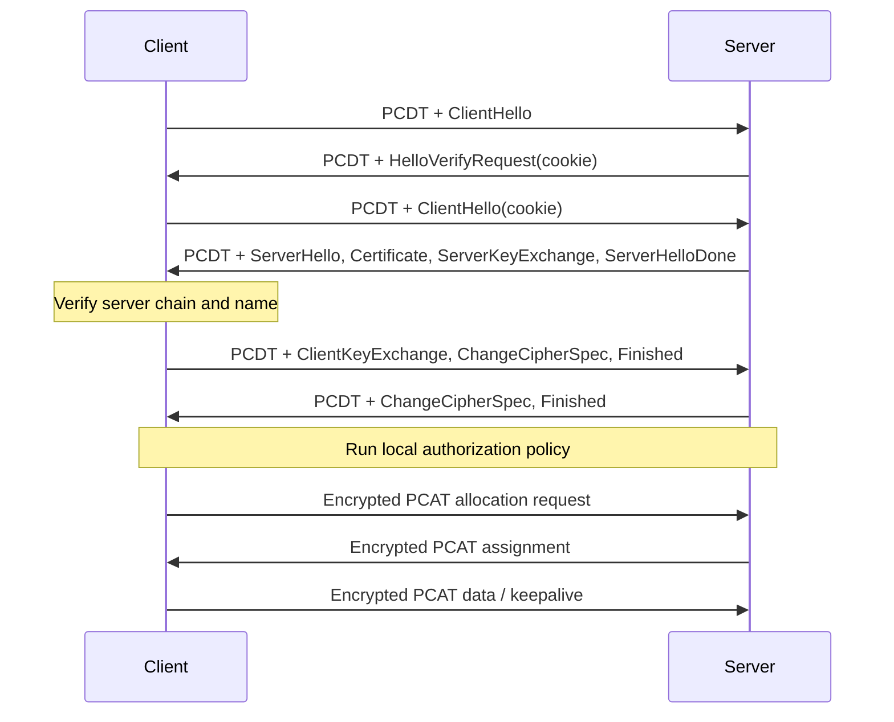

# PCAT DTLS channel profile v1

This profile protects the [PCAT session protocol](session-v1.md) with
server-authenticated DTLS 1.2. Clients verify the server certificate; the server
does not require a client certificate. For client-certificate enforcement use
[the mDTLS profile](mdtls.md), which has the same data-record layout.

## Datagram layout

One UDP payload contains a 24-byte PCAT secure-routing envelope followed by one
DTLS datagram. That datagram can contain multiple DTLS records with the same
routing ID; each application record contains one complete PCAT session message.
There is no unprotected allocation before the secure handshake completes.

```text
Ethernet / outer IPv4 / UDP
└── Secure-routing envelope (24 B, public)
    ├── Magic "PCDT" (4 B)
    ├── Version 1 (1 B), reserved zero (3 B)
    └── Client-generated routing ID (16 B)
└── DTLS application record
    ├── DTLS header (13 B, public)
    ├── Explicit AES-GCM nonce (8 B, public)
    ├── Encrypted PCAT message (N B)
    │   ├── PCAT session header (24 B)
    │   └── Allocation, inner IPv4 data, or keepalive payload
    └── AES-GCM authentication tag (16 B)
```

### Secure-routing envelope

Offsets are relative to the UDP payload. Multi-byte numeric fields are big-endian.

```text
Byte  0               4       5                       8
      +---------------+-------+-----------------------+
      | "PCDT" (4 B)  | Ver=1 | Reserved=0 (3 B)      |
      +---------------+-------+-----------------------+
Byte  8                                              24
      +----------------------------------------------+
      | Public routing ID (16 B)                     |
      +----------------------------------------------+
Byte 24
      | DTLS record(s) ...                           |
```

The client MUST generate a fresh cryptographically random routing ID for each
new connection. Both peers echo that ID in every envelope for the connection.
A server routes by source physical endpoint and routing ID. Receivers MUST reject
unknown envelope versions, nonzero reserved bytes, and truncated records. Only
an epoch-zero DTLS ClientHello can create a new server handshake slot; the DTLS
implementation validates its full contents. Unknown IDs on a client are dropped.

The envelope is not authenticated or encrypted by DTLS and MUST NOT confer
identity or allocation permission. Modifying or guessing it cannot substitute
for a valid DTLS record. The physical endpoint is fixed during a connection;
NAT rebinding, roaming, and the standardized DTLS Connection ID extension are
not part of this profile. The envelope makes this profile incompatible with a
bare DTLS socket; both peers must implement PCAT framing.

For an illustrative routing ID starting with `01` and otherwise zero, the
24-byte envelope is:

```text
50434454 01 000000 01000000000000000000000000000000
```

`TestRoutingHeaderSpecificationVector` checks this independent wire fixture.
Initial ClientHello records may use legacy version `fe ff` for compatibility;
established application records use `fe fd`. This does not enable DTLS 1.0.

### Application record offsets

For a single application record containing `N` bytes of PCAT plaintext:

| UDP offset | Size | Field |
| --- | --- | --- |
| 0 | 24 | Secure-routing envelope |
| 24 | 1 | DTLS content type: ApplicationData (`23`) |
| 25 | 2 | DTLS version: `fe fd` |
| 27 | 2 | Epoch |
| 29 | 6 | Record sequence number |
| 35 | 2 | Record fragment length: `N + 24` |
| 37 | 8 | Explicit GCM nonce |
| 45 | N | Encrypted PCAT session message |
| 45 + N | 16 | Authentication tag |

The record-header fields follow [DTLS 1.2](https://www.rfc-editor.org/rfc/rfc6347.html#section-4.1).
The explicit nonce and tag follow [TLS AES-GCM](https://www.rfc-editor.org/rfc/rfc5288.html#section-3).
Handshake and alert records have different content and are not described by this
application-record offset table.

## Cryptographic profile

Implementations MUST use DTLS 1.2 with one of these ECDHE suites:

| Cipher suite | ID |
| --- | --- |
| `TLS_ECDHE_ECDSA_WITH_AES_128_GCM_SHA256` | `c0 2b` |
| `TLS_ECDHE_RSA_WITH_AES_128_GCM_SHA256` | `c0 2f` |

These suites are defined in [RFC 5289](https://datatracker.ietf.org/doc/html/rfc5289#section-3.2).
The [Extended Master Secret extension](https://www.rfc-editor.org/rfc/rfc7627.html)
is REQUIRED. DTLS CID, custom padding, PSK authentication, and plaintext fallback
are not enabled by this profile. The adapter uses Pion DTLS v3.1.15 and does not
configure session resumption.

The client MUST validate the server's certificate chain and configured DNS name
or IP SAN. A failed check MUST stop setup. This profile does not request or verify
client certificates, so successful clients are anonymous from the server's
perspective unless additional application policy establishes identity.

## Establishment

The secure exchange uses DTLS cookie verification and retransmitted handshake
flights. The diagram summarizes the full server-authenticated handshake; detailed
record, fragmentation, and retry behavior follows
[RFC 6347](https://www.rfc-editor.org/rfc/rfc6347.html#section-4.2).



After successful verification and any authorization callback, each endpoint
assigns the connection a fresh local opaque handle. Allocation binds to that
handle as well as the physical address. Reconnecting MUST NOT reuse another
connection's allocation, even if its physical address or request ID is identical.
A closed/unknown handle MUST NOT fall back to another connection at that address.

Authorization callback details stay local. There is no PCAT authentication error
payload. DTLS may emit its standard alerts; allocation is never exposed to a
rejected connection.

## Delivery and resource limits

Application datagrams remain unordered and unreliable; inner TCP supplies stream
reliability. Duplicate or stale encrypted application records MUST be rejected.
The reference replay window is 128 records. Invalid authentication tags MUST NOT
result in plaintext delivery or renew an allocation.

The reference implementation bounds connections, including pending handshakes,
to 128 by default. It uses a 10-second handshake deadline and a five-minute idle
limit; successful application sends and receives both count as activity. Per-peer
encrypted queues and the shared plaintext queue each hold 256 datagrams. Overflow
drops new arrivals. A peer failure affects that peer; a raw endpoint failure
closes the adapter. These defaults are not negotiated fields.

Shutdown cancels I/O and handshakes and joins owned workers. Authorization
callbacks MUST honor their supplied context and MUST NOT synchronously close the
endpoint from within the callback, because endpoint closure joins that worker.

## MTU

For physical IPv4 MTU `M` and inner IPv4 packet length `P`:

```text
UDP payload = 24 routing + 37 DTLS overhead + 24 session + P
P <= M - 28 outer IPv4/UDP - 24 routing - 37 DTLS - 24 session
```

At physical MTU 1500, `P` is at most **1387 bytes**. DTLS and mDTLS use the same
application overhead. Certificate-chain size changes handshake fragmentation,
not application-record overhead.

The pinned Pion implementation reads encrypted datagrams into an 8192-byte
buffer. Accordingly the reference adapter caps DTLS datagrams at 8192 bytes,
application plaintext at **8155 bytes**, and inner packets at **8131 bytes** even
on larger physical links. Its effective application capacity is:

```text
min(raw UDP payload capacity - 24, 8192) - 37
```

This is an implementation limit, not a new field or integer width in PCAT.
`MaxDatagramSize` reports that effective capacity; the session layer additionally
subtracts its 24-byte header. Oversized sends MUST fail before injection.

## Visibility and operation

The routing envelope, outer addresses, DTLS metadata, sizes, and timing are
visible. DTLS 1.2 setup can expose certificates and the configured server name.
PCAT allocation fields, session tokens, inner addresses, and TCP payloads are
encrypted after establishment. This does not promise protocol invisibility or
eliminate implementation fingerprinting.

Use [dtlstransport](../../dtlstransport/README.md) or the
[DTLS examples](../../examples/README.md#dtls). Applications supply credentials,
trust configuration, and service authorization. Application TLS/mTLS over the
returned TCP connection is independent of this tunnel profile.
