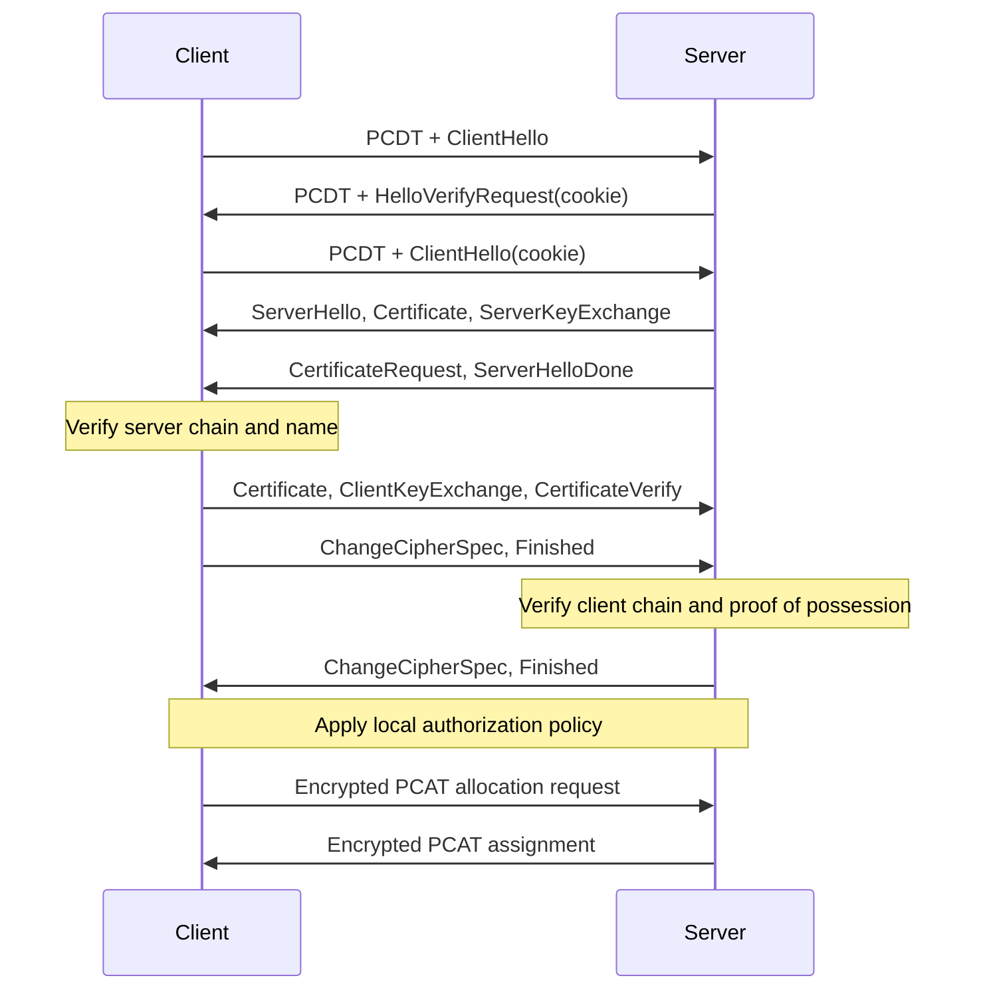

# PCAT mDTLS channel profile v1

**mDTLS** is mutually authenticated DTLS: clients verify the server and the server
requires and verifies client certificates. This profile incorporates the
[DTLS profile](dtls.md), including its routing envelope, cipher suites, replay
protection, MTU rules, and resource bounds. The difference is the required client
authentication policy before a connection can reach PCAT address allocation.

## Datagram layout

There is no mDTLS mode flag, extra packet type, or extra per-packet certificate.
The application-record layout is identical to DTLS:

```text
Ethernet / outer IPv4 / UDP
└── PCDT secure-routing envelope (24 B, public)
    ├── Magic "PCDT", version 1, reserved zero
    └── Public routing ID (16 B)
└── DTLS 1.2 application record
    ├── Header (13 B)
    ├── Explicit AES-GCM nonce (8 B)
    ├── Encrypted PCAT message
    │   ├── PCAT header (24 B)
    │   └── Allocation fields or complete inner IPv4 packet
    └── Authentication tag (16 B)
```

```text
UDP bytes:   0                    24            37       45
             +---------------------+-------------+--------+--------------------+
             | PCDT routing header | DTLS header | Nonce  | PCAT ciphertext ...|
             +---------------------+-------------+--------+--------------------+
             | ... ciphertext, followed by 16-byte GCM tag                   |
             +----------------------------------------------------------------+
```

The [DTLS offset table](dtls.md#application-record-offsets) is normative for this
profile too. Mutual authentication changes the handshake, not record overhead.

## Mutual-authentication handshake

The server MUST request a client certificate and reject a missing or invalid
chain. The client MUST prove possession of its signing key. CertificateRequest,
Certificate, and CertificateVerify have their standard
[TLS 1.2 semantics](https://www.rfc-editor.org/rfc/rfc5246.html#section-7.4),
carried by DTLS handshake flights.



All handshake flights use the PCDT envelope; intermediate arrows omit it for
readability. Handshake fragmentation and retransmission remain DTLS behavior.
The server MUST NOT expose a rejected client to the allocator. No plaintext
fallback is permitted. A new secure connection receives a new local connection
handle and must obtain its own allocation.

## Trust and authorization

The client verifies the server against `RootCAs` and `ServerName`. The server
verifies client chains against `ClientCAs` with client-authentication usage. In
the reference adapter, server policy is `RequireClientCertificate: true` and
Pion's `RequireAndVerifyClientCert` mode; the client supplies its `Certificates`.
Nil trust pools select system roots rather than disabling verification.

A trusted certificate does not automatically grant application permissions.
`Authorize` may restrict individual identities after verification and before
allocation. It must honor cancellation and return policy failures locally, without
sending its error text to peers. Applications needing explicit revocation policy
must supply it; the adapter does not provide automatic revocation retrieval or
certificate renewal.

## Credential lifecycle

Applications or deployment tooling create, store, load, rotate, and protect
certificates and private keys. PCAT does not create credential files. The example
programs load operator-supplied PEM paths; library callers can supply in-memory
credentials from their chosen secret store.

Every endpoint SHOULD have its own leaf certificate and private key. Clients may
share trusted public CA certificates; they MUST NOT receive the CA private key.
Client and server trust roots can differ. A shared organizational root is optional,
not a protocol requirement.

If applications also use mTLS inside the tunnel, separate leaf keys and issuing
CAs let tunnel-access and service-access policies evolve independently. Trusting
only the intended issuing CA, or enforcing equivalent verification policy, avoids
implicitly accepting the other credential class through a shared root.

## Operation and visibility

See [mDTLS examples](../../examples/README.md#mutual-dtls). Outer metadata and
DTLS 1.2 handshake certificates can remain visible, just as in the DTLS profile.
The client certificate can disclose identity during setup. Inner addresses,
allocation fields, and TCP data are encrypted after establishment. mDTLS is not a
promise to conceal peer identity, packet timing, or the protocol's implementation.
