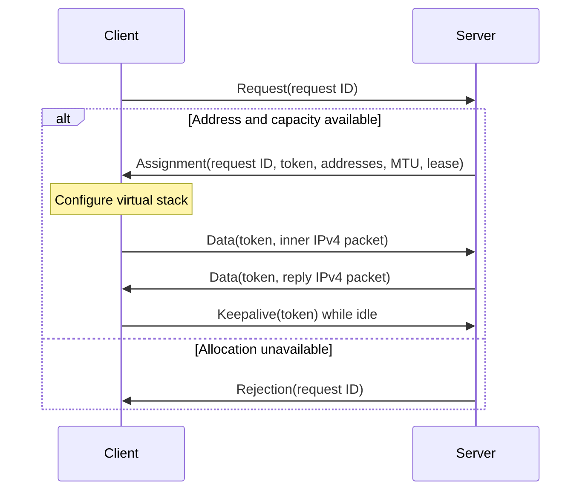

# Session protocol v1

This specification defines the plaintext session message shared by all
[channel profiles](README.md). In a secure profile, “plaintext” below means the
message before DTLS protection, not data exposed on the physical network.

## Encoding

All offsets and sizes are in bytes. Numeric fields use network byte order
(big-endian). Identifiers are exactly 16 opaque bytes. One channel application
datagram MUST contain exactly one session message; concatenating session messages
is not supported. The enclosing datagram or DTLS application record supplies its
length, so there is no additional session length field.

### Common header

```text
Byte     0               4       5       6               8
         +---------------+-------+-------+---------------+
         | Magic "PCAT"  | Ver=1 | Type  | Reserved=0    |
         |     4 B       |  1 B  |  1 B  |     2 B       |
         +---------------+-------+-------+---------------+
Byte     8                                              24
         +----------------------------------------------+
         | Request ID or session token (16 B)            |
         +----------------------------------------------+
Byte    24
         | Type-specific payload ...                    |
```

| Offset | Size | Field | Requirement |
| --- | --- | --- | --- |
| 0 | 4 | Magic | ASCII `PCAT` (`50 43 41 54` hex) |
| 4 | 1 | Version | `1` |
| 5 | 1 | Type | One of the types below |
| 6 | 2 | Reserved | Both bytes MUST be zero |
| 8 | 16 | ID | Request ID for types 1–3; session token for types 4–5 |
| 24 | Variable | Payload | Exact type-specific length |

| Type | Name | Direction | Payload size | Total session size |
| --- | --- | --- | --- | --- |
| 1 | Allocation request | Client → server | 0 | 24 |
| 2 | Assignment | Server → client | 30 | 54 |
| 3 | Rejection | Server → client | 0 | 24 |
| 4 | Data | Either direction | One inner IPv4 packet, at least 20 | 24 + inner packet size |
| 5 | Keepalive | Client → server | 0 | 24 |

A receiver MUST discard unsupported versions/types, nonzero reserved fields,
truncated headers, and invalid payload lengths. A valid message with the wrong
role or unrelated ID is ignored. Internal error strings MUST NOT be sent as
payloads. Rejection has no error-code or diagnostic field in v1.

### Assignment payload

Offsets here are relative to the beginning of the session message.

```text
Byte    24                                              40
         +----------------------------------------------+
         | Assigned session token (16 B)                |
         +----------------------+-----------------------+
Byte    40                     44                      48
         | Client IPv4 (4 B)    | Server IPv4 (4 B)      |
         +----------------------+-----------------------+
Byte    48             50                              54
         | MTU (2 B)   | Lease duration, seconds (4 B)  |
         +-------------+--------------------------------+
```

| Offset | Size | Meaning |
| --- | --- | --- |
| 24 | 16 | Newly assigned unpredictable session token |
| 40 | 4 | Assigned client IPv4 address |
| 44 | 4 | Server's virtual IPv4 address |
| 48 | 2 | Maximum complete inner IPv4 packet size |
| 50 | 4 | Idle lease duration in seconds |

Client and server virtual addresses MUST be distinct, usable IPv4 unicast
addresses. MTU MUST be at least 576, fit the channel capacity, and not exceed the
client's configured capacity. Lease duration MUST be a whole number of seconds
from 3 through 86,400 inclusive. The allocation request advertises no MTU or
address preference: these are server configuration, not negotiated parameters.
A client unable to accept the assignment MUST fail setup.

### Wire example

An assignment to client `10.200.0.3`, server `10.200.0.2`, MTU 1200, and a
120-second lease encodes as follows. Whitespace separates fields, not bytes on
the wire. IDs here are illustrative; production IDs must be random.

```text
50434154 01 02 0000
01020300000000000000000000000000
09000000000000000000000000000000
0ac80003 0ac80002 04b0 00000078
```

This 54-byte vector is checked by `TestAssignmentSpecificationVector`.

## Allocation state machine

1. A client generates a cryptographically random request ID and sends a request.
2. The server identifies the peer using the selected channel profile. If that
   peer and request ID already have a live lease, it returns the same assignment
   and renews the lease's idle timestamp.
3. Otherwise, the server reserves an available address and a cryptographically
   random session token unique among active leases. It returns Assignment with
   the request ID echoed in the header. Pool exhaustion, capacity limits, or an
   allocation failure produce only Rejection with that echoed request ID.
4. The client accepts responses only from its expected peer with the matching
   request ID. On success it configures the virtual stack before sending data.
5. Lost responses can be recovered by repeating the same request ID. A new
   request ID represents a separate allocation, even at the same physical address.



Clients MUST bound retries by a setup deadline or cancellation mechanism. The
reference implementation retries at 500 ms intervals, without changing request
ID, until its setup context expires. This interval is not a wire constant.

## Lease policy

Servers MUST exclude their own virtual address, the configured subnet address,
and its directed broadcast address from allocation. Address selection order is
not specified. The implementation supports pools from `/1` through `/30`, checks
usable host addresses, and limits active leases; defaults are a two-minute idle
lease and a maximum of 256 leases. These are implementation defaults, not fields
in an allocation request.

A valid duplicate request, Data, or Keepalive renews the corresponding idle
lease. Invalid tokens, wrong peers, forged sources, and malformed packets MUST
NOT renew a lease. Replies sent by the server do not renew it. Clients SHOULD
send Keepalive every third of the assigned lease duration when otherwise idle.
Keepalive has no response in v1 and does not prove the server is still reachable.

On expiry, the server invalidates the token, drops queued packets from that
assignment, and initiates teardown of associated TCP state before reusing the address.
There is no release, acknowledgement, or lease-resumption message. Closing a
client stops keepalives; its lease remains reserved until expiry. A restarted
server loses its allocations, and clients must establish new sessions.

## Data validation and routing

Before delivering client data, the server MUST verify:

- The session token identifies a live lease belonging to the sending peer.
- The inner packet has IPv4 version 4, a header of at least 20 bytes, a consistent
  total length, and a size within the assigned MTU.
- Its source equals the assigned client IP and its destination equals the
  server virtual IP.

The client applies the reverse address checks, its expected peer and token,
and the same IPv4 framing/MTU checks. Session framing does not implement inner
IP checksums, reassembly, or TCP state; these belong to the receiving stack.
A server resolves outbound inner destinations to their live assignments. Unknown
or expired destinations are dropped rather than terminating other peers.

UDP and DTLS application records do not provide ordered, reliable delivery.
Inner TCP handles retransmission and ordering. Bounded receive queues can drop
new packets. There is no session-level data sequence number or replay window;
cryptographic replay protection is provided only by secure channel profiles.

## Security and identifiers

No hostnames, physical interface descriptions, OS/stack versions, or internal
error text appear in session fields. This does not prevent traffic analysis or
fingerprinting of inner TCP behavior. A request ID distinguishes concurrent
requests; a token selects an assignment. Neither authenticates a plain peer.

Secure transports MUST bind a lease to the verified connection, not just its
physical address. The reference API uses `Peer.ConnectionID` for this binding.
That local handle is never serialized in a session message and MUST change on
reconnection. A token from a previous or different secure connection MUST NOT
be accepted, even if the outer UDP address is identical.

## Implementation and tests

- [Wire codec](../../session_wire.go)
- [Client](../../session_client.go), [server](../../session_server.go)
- [Session regressions](../../session_test.go)
- [Simulated Ethernet integration](../../session_integration_test.go)
